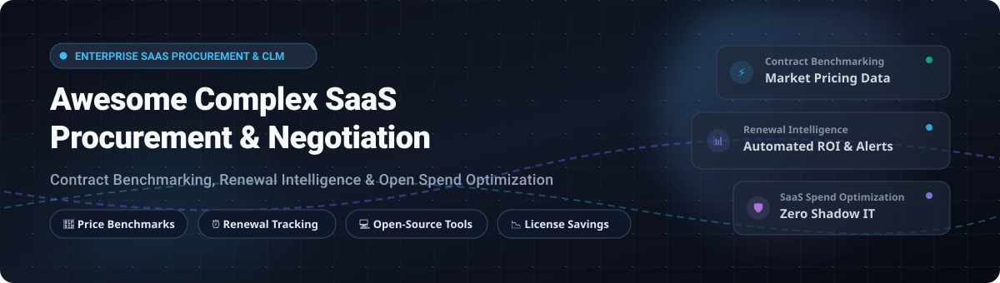

# 🚀 Awesome Complex SaaS Procurement & Negotiation Tools 

  

  
  
  
  
  

---

## 🧭 Executive Summary & Ecosystem Overview

> **Curated directory of SaaS negotiation platforms and open-source GitHub projects for SaaS procurement, IT spend management, contract intelligence, and license optimization.**

Navigating enterprise software subscriptions and SaaS contract renewals has become one of the most critical operational challenges for modern CIOs, CFOs, and procurement teams. **Awesome Complex SaaS Procurement & Negotiation Tools** compiles market-leading commercial platforms and robust open-source alternatives designed to benchmark contract terms against industry standards, track renewal deadlines, identify shadow IT, enforce license usage metering, and optimize total software spend.

### 🎯 Key Focus Areas
- 🤝 **Contract Benchmarking & Negotiation Intelligence**: Level the playing field against enterprise sales teams using historical price distribution benchmarks.
- ⏰ **Proactive Renewal Management**: Eliminate rogue auto-renewals with automated notifications (90/60/30-day workflows).
- 📉 **SaaS Spend Optimization & Deprovisioning**: Surface inactive licenses, reclaim unassigned seats, and optimize cloud allocations.
- 🔓 **Self-Hosted & Open-Source CLM**: Maintain full sovereign control over executed enterprise contracts, sensitive MSA clauses, and internal RFQ pipelines.

---

## 📑 Table of Contents

- [📊 Sector Overview & Market Dynamics](#-sector-overview--market-dynamics)
- [🏢 SaaS/Hosted Commercial Platforms](#-saashosted-commercial-platforms)
- [💻 Open-Source GitHub Projects](#-open-source-github-projects)
- [🤝 How to Contribute](#-how-to-contribute)
- [🌟 Star History](#-star-history)
- [☕ Support & Community](#-support--community)
- [⚠️ Disclaimer](#️-disclaimer)

---

## 📊 Sector Overview & Market Dynamics

The global SaaS procurement and SaaS management platform (SMP) market is estimated at **$4.5B to $5.6B in 2025** (within a broader procurement software market exceeding **$10B**), expanding rapidly as organizations grapple with multi-cloud sprawl, shadow IT, and rising AI software expenses. The sector remains **moderately fragmented**—featuring agile AI-first procurement intake and negotiation platforms competing alongside established IT asset managers and legacy ERP/procure-to-pay suites, though steady consolidation is emerging as leading platforms acquire specialized point solutions to build unified intake-to-procure ecosystems.

---

## 🏢 SaaS/Hosted Commercial Platforms

| Platform | Company Scale (Valuation / Revenue / Funding) | Starting Tier Pricing | Free Tier / Trial Limit | Key Capabilities |
| :--- | :--- | :--- | :--- | :--- |
| **[Zip](https://ziphq.com/)** | **$2.2B Valuation** ($190M Series D in 2024; ~$193M ARR; $371M total funding) | Starts at **$40,000/year** (custom enterprise contract based on user seats and modules) | **No permanent free tier or public self-serve free trial** (requires vendor sales demo & scoped enterprise proof of concept) | Intake-to-pay procurement orchestration, custom approval workflows, vendor risk management, ERP integrations, and enterprise spend visibility. |
| **[Vendr](https://www.vendr.com/)** | **$1.0B Valuation** (Acquired by Vertice in 2026; $216M funding raised; ~$60M–$95M ARR) | Starts at **$36,000/year** (annual contract based on total managed SaaS spend) | **Free tier available**: Free pricing benchmark searches, SaaS buyer guides, negotiation playbooks, and basic approval workflows (no managed buying services) | SaaS buying platform backed by billions in verified software transaction data, pricing benchmarks, negotiation playbooks, and automated intake approvals. |
| **[Vertice](https://www.vertice.one/)** | **$500M Valuation** ($50M Series C in Jan 2025; $101M total funding; ~$69M estimated revenue) | Starts at **$30,000/year** (billed annually based on software spend and module selection) | **No free tier; no public free trial** (access via scheduled sales demo and spend discovery analysis) | SaaS purchasing and cloud spend management platform providing contract benchmarking, renewal calendars, and negotiation support. |
| **[Productiv](https://productiv.com/)** | **~$350M–$450M Implied Valuation** ($73M total funding including $45M Series C; mid-to-high tens of millions ARR) | Starts at **$30,000–$40,000/year** (custom annual contract scaled by company headcount and integrations) | **No permanent free tier; no self-serve free trial** (custom guided proof-of-concept pilot available via sales) | SaaS management and engagement intelligence platform tracking real-time feature adoption, contract license optimization, and renewal intelligence. |
| **[Tropic](https://www.tropicapp.io/)** | **~$200M–$300M Implied Valuation** ($67M total funding including $40M Series B; hundreds of millions in spend managed) | Starts at **$3,167/month** ($38,000/year, Tropic Core base tier billed annually) | **No free tier; no free trial** (offers one-time complimentary price-benchmark savings analysis during procurement sales process) | AI-powered procurement platform combining intake forms, assisted vendor negotiations, automated approvals, and contract intelligence. |
| **[Torii](https://www.toriihq.com/)** | **~$100M–$250M Valuation** ($65M total funding; acquired by Freshworks in Oct 2026; ~$17M–$21M ARR) | Starts at **$0/month** for Basic tier; paid tiers average **~$32,000/year** based on employee headcount | **14-day free trial** with full feature access; **Basic free plan** limited to basic shadow IT discovery and browser/SSO visibility (no workflow automation or ERP sync) | SaaS management platform focused on automated discovery, shadow IT tracking, license deprovisioning, and renewal management. |
| **[Zylo](https://zylo.com/)** | **~$150M–$250M Implied Valuation** ($72.5M total funding; over $30B cumulative enterprise spend managed) | Starts at **~$35,000/year** (custom annual agreement scaled by headcount and application count) | **No free tier; no self-serve free trial** (requires custom enterprise product demo) | Enterprise SaaS management platform providing license utilization tracking, renewal calendars, benchmark comparisons, and shadow IT discovery. |
| **[Sastrify](https://www.sastrify.com/)** | **~$70M–$100M Valuation** ($45M–$55M total funding; acquired by Deel in May 2026; ~$27M–$31M ARR) | Starts at **€12,500/year** (~$13,500/year for core software management; procurement service tiers start at €15,000–€25,000/year) | **No free tier; no self-serve free trial** (offers tailored product demo and SaaS spend audit via sales consultation) | SaaS procurement and license management platform for SMBs and mid-market organizations with automated renewal tracking and pricing benchmarks. |
| **[Spendflo](https://www.spendflo.com/)** | **~$40M–$60M Implied Valuation** ($15.4M total funding including $11M Series A; ~$15M–$26M estimated ARR) | Starts at **$2,500/month** ($30,000/year billed annually, based on annual SaaS spend volume) | **No free tier; no free trial** (offers initial complimentary tech stack spend audit and guaranteed savings assessment) | SaaS procurement platform featuring benchmark data, managed buyer negotiations, intake workflows, and renewal management with guaranteed ROI. |
| **[Cledara](https://www.cledara.com/)** | **~$30M–$50M Implied Valuation** ($24.4M total funding; ~$10.8M estimated ARR; ~1,000 customers) | Starts at **$75/month** ($750/year billed annually for Basic tier up to 20 apps) | **No standalone free tier or free trial**; monthly fee can be waived during month 1 if paying for at least 10 software applications via Cledara virtual cards | SaaS management platform combining virtual debit cards for subscription management, spend control, approvals, and automated compliance. |

---

## 💻 Open-Source GitHub Projects

Open-source and self-hosted tools provide sovereign data privacy, audit transparency, and zero recurring vendor lock-in for IT asset management, subscription metering, contract tracking, and procurement automation. Sorted by GitHub Star Count (descending).

- **[Documenso](https://github.com/documenso/documenso)**   
  Open-source digital signature and document signing infrastructure (AGPL-3.0) designed as a privacy-first alternative to DocuSign. Essential for executing procurement contracts, NDAs, Master Service Agreements (MSAs), and Statements of Work (SOWs) with self-hosted cryptographic validation.

- **[Snipe-IT](https://github.com/snipe/snipe-it)**   
  Full-featured open-source IT asset management system (AGPL-3.0). Includes comprehensive software license tracking, seat allocations, expiration alerts, supplier management, purchase order tracking, and check-in/check-out workflows to eliminate rogue SaaS seats.

- **[Infracost](https://github.com/infracost/infracost)**   
  Cloud cost estimates for Terraform, OpenTofu, and Pulumi (Apache-2.0). Provides automated FinOps shift-left spend visibility directly in pull requests, allowing procurement and engineering teams to forecast monthly cloud software commitments before signing or deploying.

- **[Invoice Ninja](https://github.com/invoiceninja/invoiceninja)**   
  Open-source enterprise invoicing, vendor expense tracking, and subscription billing platform (Elastic License 2.0). Provides automated recurring expense logging, vendor payment tracking, and purchase order reconciliation.

- **[InvenTree](https://github.com/inventree/InvenTree)**   
  Open-source inventory, purchasing, and supplier management platform (MIT). Powers supplier catalog management, purchase orders (POs), price-break tracking, and vendor quotation comparisons for enterprise procurement pipelines.

- **[OpenCost](https://github.com/opencost/opencost)**   
  Open-source, vendor-neutral Kubernetes and cloud cost allocation engine (Apache-2.0, CNCF Sandbox Project). Delivers granular cost breakdown by container, namespace, and multi-tenant software deployment to feed accurate data into cloud SaaS renewal negotiations.

- **[CloudQuery](https://github.com/cloudquery/cloudquery)**   
  Open-source high-performance ELT framework for cloud, IT asset, and SaaS APIs (MPL-2.0). Extracts configuration and asset data from identity providers, AWS/GCP/Azure, GitHub, and SaaS tools into PostgreSQL/Snowflake for automated shadow IT auditing.

- **[GLPI](https://github.com/glpi-project/glpi)**   
  Open-source IT Service Management (ITSM) and comprehensive software asset management system (GPL-3.0). Manages software licenses, complex licensing compliance metrics, contract renewals, supplier relationships, and procurement budgets.

- **[Renewhelper](https://github.com/ieax/renewhelper)**   
  Open-source renewal reminder system with multi-channel notifications (MIT). Supports Telegram, Bark, PushPlus, NotifyX, Resend (email), Lark, WeCom, Gotify, Ntfy, ServerChan3, and DingTalk. Configurable per-service reminders with timezone accuracy, deployable on Cloudflare Workers or self-hosted.

- **[Claude Contract Renewal Radar](https://github.com/OneWave-AI/claude-skills)**   
  Autonomous agent skill for Claude Code that sweeps executed contract directories, parses expiration dates, auto-renewal penalty clauses, notice periods, and price escalation clauses, and compiles them into a structured renewal calendar with decision alerts.

- **[Keygate](https://github.com/tabloy/keygate)**   
  Open-source license management platform (MIT) positioned as a self-hosted alternative to Keygen and Cryptlex. Features subscriptions, perpetual licenses, trials, floating licenses, usage metering with atomic quota enforcement, Stripe payments, and a clean administrative dashboard.

- **[Candlepin](https://github.com/candlepin/candlepin)**   
  Open-source enterprise subscription and entitlement engine (GPL-2.0). Manages software subscriptions, consumer entitlements, and product certificates from both vendor and enterprise consumer perspectives. Powers Red Hat Subscription Management.

- **[Cloudforet](https://github.com/cloudforet-io/cloudforet)**   
  Open-source multi-cloud governance and FinOps platform (Apache-2.0). Features unified cost visibility, budget alerts, and integrated cloud service catalog tracking across AWS, Azure, and Google Cloud.

- **[draftLegal](https://github.com/AniketTati/draft-legal)**   
  Open-source contract lifecycle management platform (AGPL-3.0) positioned as a self-hosted alternative to Ironclad and Harvey. Features portfolio intelligence to benchmark vendor quotes against historical contract history, review, redline, approve, and track obligations with self-hosted AI models.

- **[Multi-Cloud FinOps Engine](https://github.com/priyaranjan-sahu/multi-cloud-finops)**   
  Open-source FinOps engine aggregating AWS, GCP, and Azure costs using FOCUS 1.0 standards. Features SaaS visibility into Stripe, Chargebee, and Zuora licenses with ML-driven seat utilization metering.

- **[MCP Procurement Server](https://github.com/zavora-ai/mcp-procurement)**   
  Open-source Model Context Protocol (MCP) server for procurement intelligence (Rust). Features RFQ creation and quote comparison, supplier risk scoring, price benchmarking (quote vs historical avg/min/max), contract clause checking, savings opportunity detection, and automated negotiation brief generation with BATNA analysis.

- **[Contract Vault CLI](https://github.com/DrBaher/contract-vault-cli)**   
  Open-source, git-backed vault for executed contracts (MIT, Python zero-dependencies). Stores contract terms as `record.json` with notice windows, renewal triggers, governing laws, and values; queries deadlines and emits `.ics` calendar files.

- **[SaaS Renewal Tracker](https://github.com/michaelhauge/pertama-partners-resources)**   
  Open-source Python script for tracking SaaS renewals and sending email reminders (MIT). Reads renewal calendar CSVs, triggers alerts 60 days before contract expiry, and includes tactical negotiation guidance for multi-year software commitments.

---

## 🛠️ Frameworks for Building Custom Procurement Stacks

Combine best-of-breed open-source modules to engineer a sovereign, enterprise-grade SaaS procurement and contract negotiation pipeline without vendor lock-in:
- **Contract Execution & Storage**: [Documenso](https://github.com/documenso/documenso) for legal e-signing + [Contract Vault CLI](https://github.com/DrBaher/contract-vault-cli) for Git-backed contract metadata versioning.
- **License Server & Usage Metering**: [Keygate](https://github.com/tabloy/keygate) or [Candlepin](https://github.com/candlepin/candlepin) for quota enforcement and seat deprovisioning.
- **Negotiation Intelligence & Agent Workflows**: [MCP Procurement Server](https://github.com/zavora-ai/mcp-procurement) for AI-driven BATNA calculation and RFQ scoring.
- **Automated Renewal & Expiry Alerts**: [Renewhelper](https://github.com/ieax/renewhelper) or [Claude Contract Renewal Radar](https://github.com/OneWave-AI/claude-skills) for multi-channel Slack/Telegram/email notification workflows.
- **Asset & Cloud Spend Reconciliation**: [Snipe-IT](https://github.com/snipe/snipe-it) + [Infracost](https://github.com/infracost/infracost) + [OpenCost](https://github.com/opencost/opencost).

---

## 🤝 How to Contribute

Contributions are warmly welcome! Help make this curated list the most comprehensive resource for software procurement:

1. 🍴 **Fork** this repository.
2. 🌿 **Create a branch**: `git checkout -b feature/add-new-tool`
3. 📝 **Add/edit entries** in `README.md` following the established format:
   - Include: Tool name, official link, GitHub star badge (if open-source), clear description, pricing details, and free tier limits.
4. ✅ **Ensure accuracy**: Verify links, pricing structures, and licensing information.
5. 🚀 **Submit a Pull Request** with a concise explanation of why the tool belongs in this list.

---

## 🌟 Star History

---

## ☕ Support & Community

Thank you for exploring and utilizing **Awesome Complex SaaS Procurement & Negotiation Tools**! 💙

If you find this repository valuable for your procurement workflows, contract benchmarks, or spend optimization projects, please consider showing your support:
- ⭐ **Star this repository** to help others discover it across GitHub.
- 🍴 **Fork and share** with fellow finance leaders, IT asset managers, and developers.
- 💬 **Join our community** on [Discord](https://discord.gg/jc4xtF58Ve) to discuss procurement strategies and tools.
- ☕ **Buy me a coffee / Sponsor the project**: Support continuous curation and maintenance via the [GitHub Sponsors Dashboard](https://github.com/sponsors/ishandutta2007).

---

## ⚠️ Disclaimer

- This is a **community-curated collection** provided for informational purposes only—not an official endorsement or legal advice.
- SaaS procurement tools processing commercial contracts, invoices, and employee records must comply with regional data protection standards (GDPR, CCPA, SOC 2, HIPAA) and corporate financial controls.
- **Negotiation leverage requires accurate market context**: Commercial platforms (Vendr, Tropic, Vertice) leverage billions in anonymized cross-vendor transactions, while open-source tools evaluate internal historical spend. Combining both strategies produces optimal negotiation outcomes.

---

  <b>Built with ❤️ for procurement managers, IT directors, finance leaders, and developers building transparent SaaS procurement solutions.</b>

